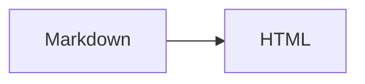
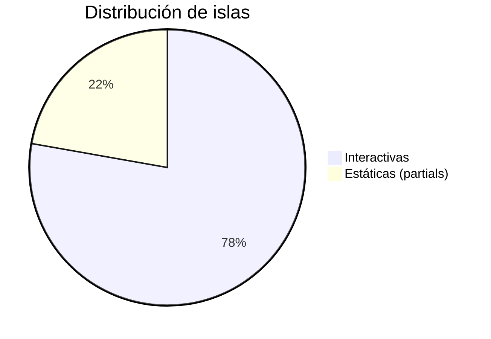

Ejemplos de las extensiones disponibles. Texto ==resaltado== y un wikilink a [[hello-godian]].

> [!note] Nota
> Un callout informativo.

> [!warning]- Plegable
> Esto se puede colapsar.

## Tabla

| Lenguaje | Tipado | Año |
|---|---|---|
| Go | Estático | 2009 |
| Python | Dinámico | 1991 |

{.sortable}

## Código

Bloque normal (sin resaltado):

```go
package main

func main() {
	println("hola")
}
```

Bloque con la línea 3 resaltada:

```go {3}
package main

func main() {
	println("hola")
}
```

## Matemáticas

Fórmula inline $e^{i\pi} + 1 = 0$ y en bloque:

$$
\sum_{n=1}^{\infty} \frac{1}{n^2} = \frac{\pi^2}{6}
$$

## Diagrama



Gráfico (pie):



## Callouts

> [!tip] Consejo
> Un callout de tipo *tip*.

> [!danger] Peligro
> Un callout de peligro.

> [!important]- Importante (plegable)
> Este callout se puede colapsar.

## Formato y listas

Texto con ~~tachado~~, ==resaltado== y un autolink: https://go.dev

- [ ] Tarea pendiente
- [x] Tarea completada

{.checklist-interactive}

1. Elemento ordenado
2. Otro elemento

Lista de tareas **visual** (sin la clase):

- [ ] Solo visual
- [x] Solo visual marcada

---

## Código con título y plegable

```go title="main.go"
package main

func main() { println("hola") }
```

```go collapsible
package main

func main() { println("hola") }
```

Líneas resaltadas (2 y 4-5):

```go {2,4-5}
package main

func main() {
	println("hola")
	println("adiós")
}
```

## Atributos

Los atributos `{.clase}` se aplican al bloque anterior:

Este párrafo lleva la clase `muted`.

{.muted}

## HTML crudo

<details>
<summary>Desplegable nativo</summary>

Contenido dentro de un `<details>`.

</details>

## Shortcode

{{youtube dQw4w9WgXcQ}}

## Componentes (islas y partials)

Muestrario corto. El catálogo completo, con todos los props y variantes, está en
la [galería de islas](/docs/islands-gallery/) y en [componentes](/docs/components/).

{{island counter start=3}}

{{island tabs items="Uno,Dos,Tres"}}

{{island accordion items="¿Qué es?=Un generador estático en Go;¿JS?=Carga diferida por isla"}}

{{island chart type="bar" data="10,20,30,40" labels="A,B,C,D" title="Ventas"}}

{{island calendar source="site" month=2 year=2026}}

{{island theme-picker}}

Componente estático (partial):

{{partial cta text="Ir a la documentación" url="/docs/"}}

## Imágenes (LQIP + presets)

Imagen normal (con LQIP y `srcset`):


Con el preset `thumb` (recorte 16:9 con foco centrado):

{{image src="/demo-1.jpg" preset="thumb" alt="Miniatura 16:9"}}

## Obsidian: enlaces, transclusión y backlinks

Enlace entre colecciones (a un doc): [[components|Componentes]].

Transclusión de una nota de documentación:

![[getting-started]]

Imagen embebida (no es nota → imagen): ![[demo-2.jpg]]
