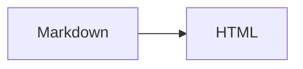
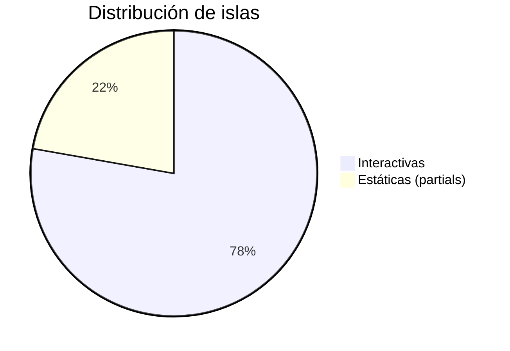

Ejemplos de las extensiones disponibles. Texto ==resaltado== y un wikilink a [[hello-godian]].

> [!note] Nota
> Un callout informativo.

> [!warning]- Plegable
> Esto se puede colapsar.

## Tabla

| Lenguaje | Tipado | Año |
|---|---|---|
| Go | Estático | 2009 |
| Python | Dinámico | 1991 |

{.sortable}

## Código

Bloque normal (sin resaltado):

```go
package main

func main() {
	println("hola")
}
```

Bloque con la línea 3 resaltada:

```go {3}
package main

func main() {
	println("hola")
}
```

## Matemáticas

Fórmula inline $e^{i\pi} + 1 = 0$ y en bloque:

$$
\sum_{n=1}^{\infty} \frac{1}{n^2} = \frac{\pi^2}{6}
$$

## Diagrama



Gráfico (pie):



## Callouts

> [!tip] Consejo
> Un callout de tipo *tip*.

> [!danger] Peligro
> Un callout de peligro.

> [!important]- Importante (plegable)
> Este callout se puede colapsar.

## Formato y listas

Texto con ~~tachado~~, ==resaltado== y un autolink: https://go.dev

- [ ] Tarea pendiente
- [x] Tarea completada

1. Elemento ordenado
2. Otro elemento

---

## Código con título y plegable

```go title="main.go"
package main

func main() { println("hola") }
```

```go collapsible
package main

func main() { println("hola") }
```

Líneas resaltadas (2 y 4-5):

```go {2,4-5}
package main

func main() {
	println("hola")
	println("adiós")
}
```

## Atributos

Los atributos `{.clase}` se aplican al bloque anterior:

Este párrafo lleva la clase `muted`.

{.muted}

## HTML crudo

<details>
<summary>Desplegable nativo</summary>

Contenido dentro de un `<details>`.

</details>

## Shortcode

{{youtube dQw4w9WgXcQ}}

## Componentes (islas)

Contador interactivo:

{{island counter start=3}}

Pestañas:

{{island tabs items="Uno,Dos,Tres"}}

Acordeón:

{{island accordion items="¿Qué es?=Un generador estático en Go;¿JS?=Carga diferida por isla"}}

Componente estático (partial):

{{partial cta text="Ir a la documentación" url="/docs/"}}

### Más componentes

{{island copy text="Texto copiado desde una isla" label="Copiar texto"}}

{{island spoiler text="Contenido oculto que se revela al pulsar." label="Mostrar secreto"}}

{{island progress value=72 max=100 label="Progreso del tutorial"}}

{{island theme-picker}}

{{island rating value=3}}

{{island carousel images="/demo-1.jpg,/demo-2.jpg,/demo-3.jpg"}}

{{island video id="dQw4w9WgXcQ" title="Demo"}}

{{island share}}

{{island clock}}

{{island countdown to="2030-01-01T00:00:00"}}

{{island gallery images="/demo-1.jpg,/demo-2.jpg,/demo-3.jpg"}}

Componentes estáticos (partials):

{{partial badge text="Nuevo" color="#16a34a"}}

{{partial kbd keys="Ctrl+K"}}

{{#partial callout title="Aviso"}}
Esto es **Markdown** dentro de un partial.
{{/partial}}

Enlace externo: [go.dev](https://go.dev) y enlace interno: [Docs](/docs/).

### Nuevos componentes

Modal:

{{island modal label="Abrir modal" title="Título" text="Contenido del modal" action="Aceptar" size="lg"}}

Popover:

{{island popover label="Info" text="Detalle del popover"}}

Anillo de progreso:

{{island progress-ring value=72 max=100 size=80 label="72%"}}

Toast:

{{island toast message="Guardado correctamente" type="success" label="Mostrar toast"}}

Chart (barras):

{{island chart type="bar" data="10,20,30,40" labels="A,B,C,D" title="Ventas"}}

Chart (pie):

{{island chart type="pie" data="14,4" labels="Islas,Partials" title="Componentes"}}

Audio:

{{island audio src="/demo-audio.mp3" title="Audio de ejemplo"}}

Lightbox:

{{island lightbox src="/demo-1.jpg" alt="Demo" caption="Figura 1"}}

Count-up:

{{island count-up value=1234 duration=1200 suffix="+"}}

Steps:

{{island steps items="Paso 1,Paso 2,Paso 3"}}

Timeline:

{{island timeline items="2026-01:Lanzamiento,2026-02:Tema nuevo,2026-03:Islas"}}

QR code:

{{island qr-code text="https://godian" size=160}}

Kanban:

{{island kanban columns="Todo,Doing,Done" cards="Tarea A,Tarea B,Tarea C"}}

Calendar:

{{island calendar month=10 year=2026 events="5:Reunión,12:Entrega,20:Review"}}

Calendar del sitio (marca los días con posts/docs):

{{island calendar source="site" month=2 year=2026}}

Partials nuevos:

{{partial callout type="warn" title="Aviso" text="Texto de aviso"}}

{{partial stat value=42 label="posts"}}

{{partial avatar src="/demo-1.jpg" alt="Nef" size=48}}

{{partial chip text="Go" color="#00add8"}}

{{partial figure src="/demo-1.jpg" alt="Demo" caption="Figura 1" width=1200 height=630}}

{{partial quote text="Godian es minimalista." author="Nef"}}

{{partial divider label="Sección"}}

{{partial divider label="Fin"}}

## Imágenes (LQIP + presets)

Imagen normal (con LQIP y `srcset`):


Con el preset `thumb` (recorte 16:9 con foco centrado):

{{image src="/demo-1.jpg" preset="thumb" alt="Miniatura 16:9"}}

## Obsidian: enlaces, transclusión y backlinks

Enlace entre colecciones (a un doc): [[components|Componentes]].

Transclusión de una nota de documentación:

![[getting-started]]

Imagen embebida (no es nota → imagen): ![[demo-2.jpg]]
