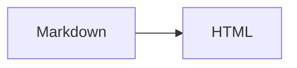

Ejemplos de las extensiones disponibles. Texto ==resaltado== y un wikilink a [[hello-godian]].

> [!note] Nota
> Un callout informativo.

> [!warning]- Plegable
> Esto se puede colapsar.

## Tabla

| Lenguaje | Tipado | Año |
|---|---|---|
| Go | Estático | 2009 |
| Python | Dinámico | 1991 |

{.sortable}

## Código

```go {2}
package main

func main() {
	println("hola")
}
```

## Matemáticas

Fórmula inline $e^{i\pi} + 1 = 0$ y en bloque:

$$
\sum_{n=1}^{\infty} \frac{1}{n^2} = \frac{\pi^2}{6}
$$

## Diagrama



## Componentes (islas)

Contador interactivo:

{{island counter start=3}}

Pestañas:

{{island tabs items="Uno,Dos,Tres"}}

Acordeón:

{{island accordion items="¿Qué es?=Un generador estático en Go;¿JS?=Carga diferida por isla"}}

Componente estático (partial):

{{partial cta text="Ir a la documentación" url="/docs/"}}

### Más componentes

{{island copy text="Texto copiado desde una isla" label="Copiar texto"}}

{{island spoiler text="Contenido oculto que se revela al pulsar." label="Mostrar secreto"}}

{{island progress value=72 max=100 label="Progreso del tutorial"}}

{{island theme-picker}}

{{island rating value=3}}

{{island carousel images="https://picsum.photos/id/10/800/450,https://picsum.photos/id/20/800/450,https://picsum.photos/id/30/800/450"}}

Enlace externo: [go.dev](https://go.dev) y enlace interno: [Docs](/docs/).
